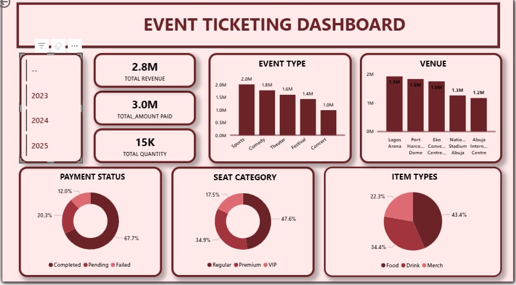

# Event Ticketing Dashboard (Power BI)

An interactive Power BI dashboard that analyses event ticket sales: revenue by event type and venue, seat category and item mix, and payment status, with a year filter for 2023 to 2025.



## Table of contents

- [Project overview](#project-overview)
- [Business questions](#business-questions)
- [Headline numbers](#headline-numbers)
- [Dataset](#dataset)
- [Tools used](#tools-used)
- [Repository structure](#repository-structure)
- [Data preparation](#data-preparation)
- [Dashboard features](#dashboard-features)
- [Key insights](#key-insights)
- [Recommendations](#recommendations)
- [Limitations and next steps](#limitations-and-next-steps)
- [How to open the project](#how-to-open-the-project)
- [Author](#author)

## Project overview

Event organisers need to know which events and venues earn the most, how customers pay, and which seats and add-ons sell best. This project turns ticketing records into a one-page dashboard so that non-technical users can explore sales patterns and filter every visual by year.


## Business questions

1. How much revenue do ticket sales generate, and how much has actually been paid?
2. Which event types and venues perform best?
3. How many payments are completed, pending or failed?
4. Which seat categories and add-on items (food, drink, merchandise) sell most?
5. How do results change by year?

## Headline numbers

| KPI | Value |
| --- | --- |
| Total revenue | 2.8M |
| Total amount paid | 3.0M |
| Total quantity | 15K |


## Dataset

- **Source:** [Medical Record]
- **Period covered:** 2023 to 2025 

| Field | Description |
| --- | --- |
| Event Type | Sports, Comedy, Theater, Festival, Concert |
| Venue | Lagos Arena, Port Harcourt Dome, Eko Convention Centre, National Stadium Abuja, Abuja International Centre |
| Seat Category | Regular, Premium, VIP |
| Item Type | Food, Drink, Merch |
| Payment Status | Completed, Pending, Failed |
| Quantity | Number of tickets or items per order |
| Revenue and Amount Paid | Order value and amount received |
| Date | Used to build the Year field |


## Tools used

- **Microsoft Excel:** Data Preparation
- **Power BI Desktop:** data model, DAX measures, report design and slicers
- **Power Query:** data cleaning and preparation
- **DAX:** KPI measures

## Repository structure

```
event-ticketing-dashboard/
├── README.md
├── data/
│   └── event_ticketing_data.csv
├── powerbi/
│   └── Event_Ticketing_Dashboard.pbix
├── screenshots/
│   └── dashboard.png
└── docs/
    └── Project_Summary.pdf
```

## Data preparation

| Step | Action |
| --- | --- |
| Check blanks and duplicates | Removed duplicates and handled missing values  |
| Fix data types | Set dates, numbers and text correctly |
| Handle missing dates |
| Standardise categories | Consistent names for event types, venues and statuses |
| Create Year | Extracted the year from the event or purchase date |
| Build measures | Total Revenue, Total Amount Paid and Total Quantity as DAX measures |

## Dashboard features

- **KPI cards:** Total Revenue, Total Amount Paid, Total Quantity
- **Charts:**
  - Revenue by event type (column)
  - Revenue by venue (column)
  - Payment status (donut)
  - Seat category (donut)
  - Item types (pie)
- **Slicer:** Year (2023, 2024, 2025)
- **Design:** one maroon and blush theme with consistent card styling

## Key insights

| Area | Finding |
| --- | --- |
| Event type | Sports leads at 2.0M, then Comedy 1.8M, Theater 1.6M, Festival 1.4M; Concert is lowest at 1.0M |
| Venue | Lagos Arena 1.9M, Port Harcourt Dome 1.8M and Eko Convention Centre 1.8M lead; National Stadium Abuja 1.3M and Abuja International Centre 1.2M trail |
| Payment status | 67.7% completed, 20.3% pending, 12.0% failed |
| Seat category | Regular 47.6%, Premium 34.9%, VIP 17.5% |
| Item types | Food 43.4%, Drink 34.4%, Merch 22.3% |

**In short**

1. Sports events generate the most revenue and Concerts the least.
2. Three venues (Lagos Arena, Port Harcourt Dome, Eko Convention Centre) bring in most of the revenue.
3. About one in three payments is not completed (pending or failed), which is a revenue risk.
4. Nearly half of seats sold are Regular; VIP is under a fifth of sales.
5. Food is the best-selling add-on, ahead of drinks and merchandise.

## Recommendations

1. **Payments:** follow up on pending payments and investigate why 12% of payments fail (for example payment gateway issues).
2. **Sports and Comedy:** schedule more of the best-performing event types, and review why Concerts lag.
3. **Venues:** study what makes the top three venues perform and apply it to the Abuja venues.
4. **Seats:** test promotions and bundles to grow Premium and VIP sales.
5. **Add-ons:** bundle food with tickets and promote merchandise, which is the weakest add-on.


## How to open the project

1. Download or clone this repository.
2. Open `powerbi/Event_Ticketing_Dashboard.pbix` in **Power BI Desktop** (free from Microsoft).


## Author

**Michael Emmanuel**

- LinkedIn: [www.linkedin.com/in/michael-emmanuel-94758b292]
- Email: [michaelemmanuel685@gmail.com]
